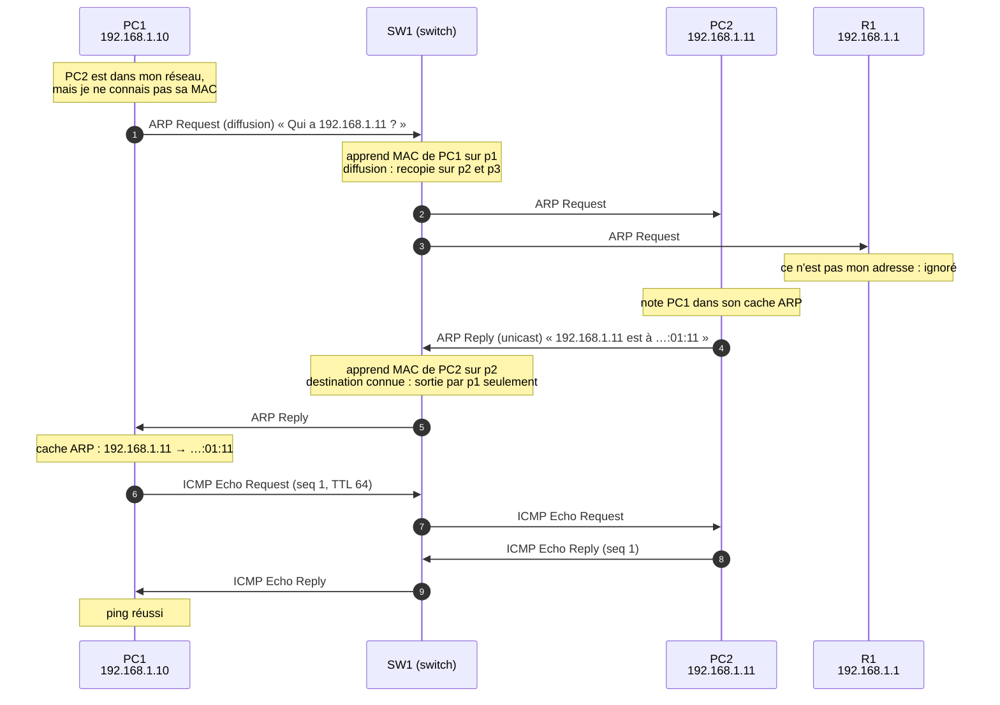

# Diagramme de séquence du ping

> Premier jet (S3). Il sera finalisé en S6, quand le routage statique et le TTL seront en place.
Scénario `scenarios/ping.json`, étape 1 : **PC1 (192.168.1.10) envoie un ping à PC2 (192.168.1.11)**,
dans le même réseau, caches ARP et table MAC vides au départ.

Ce qu'il faut retenir :

1. **ARP précède toujours le premier paquet IP** vers une adresse dont la MAC est inconnue.
2. La requête ARP est une **diffusion** (tout le réseau local la reçoit) ; la réponse est **unicast**.
3. Le switch **apprend** les adresses MAC à chaque trame reçue, puis cesse d'inonder ses ports.
